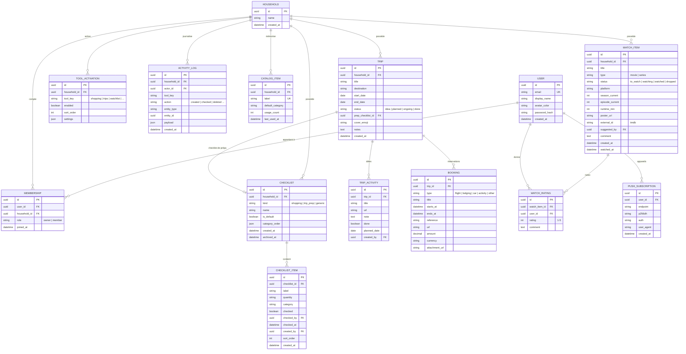
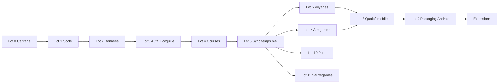

# Plan de projet — « Notre app » (outils partagés à deux)

> Document de cadrage destiné à être découpé en lots et distribué à plusieurs agents (Claude Code).
> Chaque lot est autonome, a des entrées/sorties définies et des critères d'acceptation.
> Les sections marquées **❓** sont des points à trancher (phase de grilling) avant de lancer les lots de code.

---

## 0. Vision et périmètre

### 0.1 En une phrase
Une petite application web, installable sur Android, où deux personnes (toi et ta copine) partagent des **outils** (liste de courses, voyages, films/séries à voir) dans un espace commun, chacun avec son propre compte.

### 0.2 Principes directeurs
1. **Simple avant extensible** — mais l'architecture doit permettre d'ajouter un outil sans toucher au reste.
2. **Deux utilisateurs, un espace** — pas de multi-tenant complexe, mais un modèle « espace partagé » quand même, pour ne pas se bloquer si un jour un troisième membre (famille, coloc) doit entrer.
3. **Mobile d'abord** — l'usage principal sera au téléphone, souvent debout dans une épicerie ou sur un canapé.
4. **Synchronisation quasi temps réel** — si elle coche « lait », tu dois le voir dans la seconde.
5. **Sécurisé mais sans friction** — connexion rare (session longue), aucune donnée exposée publiquement.

### 0.3 Hors périmètre (v1)
- Partage avec des personnes extérieures (liens publics).
- Application iOS native (une PWA fonctionnera sur iPhone en mode dégradé, c'est suffisant).
- Mode hors-ligne complet avec résolution de conflits (voir §5 — on vise un hors-ligne « lecture + file d'attente d'écritures simples »).
- Monétisation, onboarding public, inscription libre.

---

## 1. Les outils (fonctionnalités de base)

Le cœur conceptuel : un **outil** = un module fonctionnel avec ses propres écrans et ses propres entités, branché sur le socle commun (auth, espace partagé, sync, notifications).

### 1.1 Socle commun (transversal à tous les outils)
- Authentification (2 comptes), session longue, déconnexion.
- Espace partagé (« household ») : les deux comptes y appartiennent.
- Écran d'accueil = grille d'outils activés + raccourcis.
- Sync temps réel (ou polling court) sur toutes les listes.
- Historique léger : qui a fait quoi, quand (« ajouté par Auriane il y a 2 min »).
- Notifications push (optionnel v1, voir §5.4).
- Thème clair/sombre, FR par défaut.

### 1.2 Outil « Courses »
- Plusieurs listes possibles (Épicerie, Pharmacie, Costco…), avec une liste par défaut.
- Items : nom, quantité/note facultative, catégorie (rayon), coché / non coché, qui l'a ajouté.
- Cocher = passe dans la zone « dans le panier » en bas ; « vider les cochés » en un geste.
- Catalogue d'items fréquents (auto-complétion sur ce qu'on a déjà acheté) — gros gain d'usage.
- Tri par rayon (ordre du magasin, réordonnable).
- Ajout rapide : champ texte + Entrée, saisie multiple (« lait, œufs, pain »).

### 1.3 Outil « Voyages »
- Un voyage = destination, dates (facultatives), statut (idée / planifié / en cours / terminé).
- Sous-sections par voyage :
  - **Idées / à faire sur place** (liste d'activités, avec lien et note).
  - **Checklist de préparation** (valise, documents, réservations) — même mécanique que les courses, réutilisable.
  - **Réservations** : type (vol, hébergement, location, activité), date, référence, lien, pièce jointe facultative.
  - **Budget simple** : montant prévu / dépensé par poste (facultatif v1 ❓).
- Vue « prochain voyage » sur l'accueil.

### 1.4 Outil « À regarder » (films & séries)
- Un item = titre, type (film / série), statut (à voir / en cours / vu / abandonné), plateforme, qui l'a proposé, note perso (1–5) de chacun, commentaire.
- Pour les séries : saison / épisode en cours.
- Enrichissement optionnel via une API externe (affiche, synopsis, durée) — TMDB est gratuit pour usage perso ❓.
- Filtre « on peut regarder ce soir » = à voir + durée ≤ X + plateforme dispo.
- Tirage au sort parmi les « à voir » quand on n'arrive pas à choisir.

### 1.5 Outils candidats futurs (pour valider l'extensibilité du modèle)
- Recettes / planning repas (se branche naturellement sur les courses).
- Dépenses partagées (style Tricount).
- Dates et rappels (anniversaires, renouvellements).
- Notes / liens en vrac.

---

## 2. Modèle de données

### 2.1 Choix structurant : tables dédiées vs document générique ❓

Deux approches pour supporter « des outils qui se rajoutent » :

| Approche | Principe | Avantages | Inconvénients |
|---|---|---|---|
| **A. Tables dédiées par outil** | Chaque outil a ses tables (`shopping_item`, `trip`, `watch_item`…) | Requêtes claires, typage fort, validations simples, migrations explicites | Ajouter un outil = migration + nouvelles tables |
| **B. Noyau générique « Collection / Item »** | Une table `item` avec un champ `kind` et un `data` JSON | Zéro migration pour un nouvel outil | Requêtes et validations plus faibles, dérive vers le « fourre-tout » |

**Recommandation : A, avec un socle générique minimal** (espace, membres, outils activés, journal d'activité). Chaque outil apporte ses tables. À deux utilisateurs, le coût des migrations est nul comparé au confort d'un schéma propre. Les listes de type « cases à cocher » (courses, checklist voyage) partagent une **même table `checklist` / `checklist_item`** pour éviter la duplication.

### 2.2 Schéma (ERD)



### 2.3 Notes de conception
- **`household_id` partout** : même à deux, toutes les requêtes filtrent par espace. C'est ce qui rend la sécurité simple (une règle : « tu vois ce qui appartient à ton espace »).
- **`CHECKLIST` réutilisée** : courses et checklist de préparation voyage sont la même entité avec un `kind` différent. Un futur outil « packing list » ou « to-do maison » réutilise tout.
- **`CATALOG_ITEM`** : alimenté automatiquement à chaque ajout de course ; c'est ce qui rend l'ajout rapide vraiment rapide.
- **`ACTIVITY_LOG`** : sert à la fois à l'historique affiché (« Auriane a coché 3 items ») et, plus tard, aux notifications.
- **`TOOL_ACTIVATION`** : table de registre. Ajouter un outil = (1) ses tables, (2) une entrée ici, (3) un module front. Rien d'autre à toucher.
- **Suppression** : préférer `archived_at` / soft delete sur les entités « lourdes » (listes, voyages), suppression physique sur les items.
- **Identifiants** : UUID v7 (triables chronologiquement) plutôt que des entiers auto-incrémentés, pour faciliter la génération côté client en mode hors-ligne.

---

## 3. Architecture technique

### 3.1 Recommandation de stack ❓
L'objectif est de minimiser le nombre de pièces à opérer. Deux options sérieuses :

| | Option 1 — « BaaS » (Supabase) | Option 2 — « tout-en-un » (Next.js / SvelteKit + Postgres) |
|---|---|---|
| Auth | Supabase Auth (email + mot de passe, magic link) | Auth.js / Lucia |
| Base | Postgres managé + Row Level Security | Postgres (Neon, Railway, ou VPS) + ORM (Drizzle/Prisma) |
| Temps réel | Supabase Realtime (intégré) | WebSocket maison, SSE, ou polling 5 s |
| Front | React/Vite ou SvelteKit, PWA | Même chose, SSR possible |
| Hébergement | Vercel/Netlify (front) + Supabase (gratuit à 2 users) | Vercel + base managée |
| Effort socle | Faible | Moyen |
| Contrôle | Dépendance Supabase | Total |

**Recommandation : Option 1 (Supabase)** pour ce projet : auth, base, temps réel, stockage de fichiers et RLS sont fournis, et à deux utilisateurs tout tient dans le palier gratuit. Le front en **React + Vite + TypeScript** (familier) ou **SvelteKit** (plus léger pour une PWA). Tailwind + shadcn/ui pour aller vite.

> Si tu préfères garder la main sur tout (auto-hébergé sur ton serveur perso), l'option 2 reste valable ; prévoir alors ~1 lot de plus pour le socle (auth + temps réel).

### 3.2 Structure modulaire du front
```
src/
  core/            # auth, household, sync, layout, notifications
  tools/
    shopping/      # écrans, hooks, requêtes de l'outil Courses
    trips/
    watchlist/
  tools/registry.ts  # liste des outils : clé, icône, route, composant
```
Un outil = un dossier + une ligne dans `registry.ts`. La page d'accueil lit le registre et `TOOL_ACTIVATION`.

### 3.3 Sécurité (2 utilisateurs)
- **Pas d'inscription ouverte** : comptes créés manuellement (seed) ou inscription désactivée après la création des deux comptes.
- **Row Level Security** sur toutes les tables : `household_id IN (select household_id from membership where user_id = auth.uid())`.
- Sessions longues (30–90 jours) avec refresh token, déconnexion possible depuis un appareil.
- HTTPS obligatoire (requis de toute façon pour PWA, service worker et push).
- Pièces jointes (réservations) dans un bucket privé, URLs signées à durée limitée.
- Sauvegarde : export JSON périodique de l'espace (petit script ou fonction planifiée).
- Secrets uniquement côté serveur / variables d'environnement ; la clé TMDB ne doit pas être dans le bundle front (passer par une fonction edge ou un proxy).

---

## 4. Disponibilité sur Android — options et efforts

### 4.1 Les trois voies

| Voie | Ce que c'est | Effort supplémentaire | Résultat |
|---|---|---|---|
| **A. PWA installable** | Manifest + service worker ; « Ajouter à l'écran d'accueil » depuis Chrome | **Faible** (~½ lot) | Icône sur l'écran d'accueil, plein écran, cache hors-ligne, **push notifications supportées sur Android** |
| **B. PWA empaquetée (TWA via Bubblewrap / PWABuilder)** | On génère un APK/AAB qui enveloppe la PWA | **Faible à moyen** (+ compte Play Console 25 $ si distribution via le Store ; sinon APK installé directement) | Vraie « app » dans le tiroir, mais c'est toujours ton site web dedans |
| **C. Capacitor** | Le même front web dans une coquille native avec accès aux API natives | **Moyen** (build Android Studio, plugins natifs) | Nécessaire seulement si tu veux des capacités natives : widgets, partage système avancé, biométrie, contacts… |
| **D. Expo / React Native** | Réécriture de l'UI en natif | **Élevé** (deux codebases ou un code partagé complexe) | Hors de proportion pour ce besoin |

**Recommandation : A pour la v1, B si vous voulez l'app dans le tiroir et pas « juste un raccourci ».** Capacitor reste une porte de sortie plus tard sans rien jeter, puisque c'est le même front.

### 4.2 Ce que « connecté » implique concrètement
- **Session persistante** : le token de session doit survivre à la fermeture de l'app et aux redémarrages du téléphone (stockage local chiffré par l'OS dans le cas PWA/TWA ; c'est natif).
- **Reconnexion silencieuse** : refresh token automatique au réveil de l'app.
- **Réveil du temps réel** : rouvrir la connexion Realtime quand l'app revient au premier plan (`visibilitychange`).
- **Hors-ligne pragmatique** (v1) : service worker qui sert le shell de l'app + dernier état connu en cache ; les écritures hors connexion sont mises en file d'attente et rejouées (pattern « outbox »). Pas de fusion de conflits : dernier écrit gagne, c'est acceptable à deux.
- **Push** : Web Push fonctionne nativement sur Android (Chrome), avec `PUSH_SUBSCRIPTION` + une fonction serveur qui envoie via VAPID. Cas d'usage : « Auriane a ajouté 5 items à la liste Épicerie ».

### 4.3 Points de vigilance Android
- Icônes maskable (512 px), `theme_color`, écran de démarrage généré par le manifest.
- Comportement du clavier virtuel sur les champs en bas d'écran (viewport `interactive-widget=resizes-content`).
- Bouton « retour » Android : gérer l'historique de navigation pour que retour ferme un modal avant de quitter l'app.
- Testing : Chrome DevTools remote debugging via USB.

---

## 5. Défis et questions à trancher (phase de grilling) ❓

À passer en revue **avant** de lancer les lots de code. Chaque question a une proposition par défaut ; il suffit de confirmer ou d'amender.

### 5.1 Produit
1. Nom de l'app et identité visuelle (couleur, icône) ? — *Défaut : nom provisoire, palette neutre, à itérer plus tard.*
2. Les trois outils sont-ils tous en v1, ou on livre Courses d'abord pour valider le socle ? — *Défaut : socle + Courses = v1 utilisable ; Voyages et À regarder = v1.1 et v1.2.*
3. Budget voyage en v1 ? — *Défaut : non.*
4. Enrichissement TMDB en v1 ? — *Défaut : oui, c'est ce qui rend l'outil agréable, et c'est peu coûteux.*
5. Notifications push en v1 ? — *Défaut : v1.1, après validation de l'usage réel.*
6. Un seul espace partagé en dur, ou possibilité d'en créer d'autres (ex. un espace « colocation ») ? — *Défaut : un seul, mais le modèle le permet.*

### 5.2 Technique
7. Supabase (managé) ou auto-hébergé sur ton infra perso ? — *Défaut : Supabase.*
8. React/Vite ou SvelteKit ? — *Défaut : React + Vite + TS (vitesse d'exécution avec Claude Code et ta familiarité).*
9. Temps réel par abonnement Realtime ou polling ? — *Défaut : Realtime, avec repli polling si la connexion est instable.*
10. Niveau de hors-ligne : lecture seule en cache, ou file d'attente d'écritures ? — *Défaut : lecture + outbox simple pour les cases à cocher uniquement.*
11. Distribution Android : PWA seule, APK partagé entre vous deux, ou Play Store ? — *Défaut : PWA d'abord, APK via PWABuilder si vous voulez l'icône « vraie app ».*
12. Nom de domaine et hébergement du front ? — *Défaut : sous-domaine perso + Vercel/Netlify.*

### 5.3 Données et sécurité
13. Création des comptes : seed manuel ou page d'inscription protégée par code d'invitation, désactivée ensuite ? — *Défaut : seed manuel.*
14. Méthode de connexion : mot de passe, magic link par courriel, ou les deux ? — *Défaut : mot de passe + option magic link.*
15. Durée de session ? — *Défaut : 60 jours glissants.*
16. Sauvegardes : export automatique hebdomadaire vers un stockage à toi ? — *Défaut : oui, JSON dans un bucket ou par courriel.*
17. Suppression : une personne peut-elle supprimer ce que l'autre a ajouté ? — *Défaut : oui, tout est commun, mais c'est journalisé.*

### 5.4 Points durs identifiés
- **Conflits d'édition simultanée** : deux personnes cochent/décochent en même temps — accepter « dernier écrit gagne », mais utiliser des mises à jour atomiques par champ (pas d'écrasement de l'objet entier).
- **Fiabilité du temps réel sur mobile** : les connexions WebSocket meurent en arrière-plan ; prévoir reconnexion + refetch au retour au premier plan.
- **Push sans serveur applicatif** : avec Supabase, les envois push passent par une Edge Function déclenchée par un trigger de base ; à cadrer dans le lot Notifications.
- **Dérive « fourre-tout »** : garder la discipline « un outil = un dossier + ses tables ». Le registre d'outils est la garde-fou.

---

## 6. Découpage en lots (pour orchestration multi-agents)

Convention : chaque lot livre du code mergeable, des tests, et une note `LOT-xx.md` dans `/docs` décrivant ce qui a été fait et les décisions prises. Les lots d'un même niveau peuvent tourner en parallèle.

### Niveau 0 — Fondations (séquentiel)

**Lot 0 — Cadrage et décisions**
- Entrée : ce document.
- Travail : passer les questions §5 en revue avec toi (grilling), produire `DECISIONS.md` avec chaque réponse.
- Sortie : `DECISIONS.md`, nom du projet, stack arrêtée.
- Acceptation : aucune question ❓ non tranchée.

**Lot 1 — Squelette du dépôt et socle technique**
- Entrée : `DECISIONS.md`.
- Travail : init monorepo ou repo simple, front (Vite/React/TS/Tailwind/shadcn), lint, tests, CI minimale, config PWA de base (manifest + service worker « app shell »), structure `core/` + `tools/registry.ts` vide, projet Supabase (ou base locale via Docker), variables d'environnement, `CLAUDE.md` décrivant les conventions.
- Sortie : app vide qui démarre, se déploie en preview, s'installe sur Android.
- Acceptation : `npm run dev`, `npm run test`, `npm run build` passent ; déploiement preview accessible en HTTPS.

**Lot 2 — Modèle de données socle et migrations**
- Entrée : §2 de ce document, `DECISIONS.md`.
- Travail : migrations SQL pour `USER` (via auth), `HOUSEHOLD`, `MEMBERSHIP`, `TOOL_ACTIVATION`, `ACTIVITY_LOG`, `CHECKLIST`, `CHECKLIST_ITEM`, `CATALOG_ITEM` ; policies RLS ; script de seed (2 comptes, 1 espace) ; types TypeScript générés.
- Sortie : schéma versionné, seed rejouable, types partagés.
- Acceptation : tests d'accès prouvant qu'un compte hors espace ne voit rien.

**Lot 3 — Authentification, espace, coquille d'app**
- Entrée : lots 1 et 2.
- Travail : écrans connexion / déconnexion, session persistante, garde de routes, chargement de l'espace et des outils activés, layout mobile (barre d'onglets ou grille d'accueil), thème clair/sombre, gestion du bouton retour Android.
- Sortie : on se connecte, on voit l'accueil avec les outils activés (vides).
- Acceptation : parcours connexion → accueil → fermeture app → réouverture sans reconnexion.

### Niveau 1 — Premier outil et sync (le lot 4 débloque la v1)

**Lot 4 — Outil Courses (MVP)**
- Entrée : lot 3, §1.2.
- Travail : listes, items, cocher/décocher, zone panier, vider les cochés, ajout rapide multi-items, catalogue avec auto-complétion, catégories et tri par rayon, journal d'activité affiché.
- Sortie : outil Courses complet et utilisable.
- Acceptation : scénario « courses du samedi » réalisé à deux sur deux téléphones.

**Lot 5 — Synchronisation temps réel et résilience mobile**
- Entrée : lot 4.
- Travail : abonnement Realtime sur les tables de l'espace, invalidation de cache, reconnexion au retour au premier plan, repli polling, outbox hors-ligne pour les cases à cocher, indicateur d'état de connexion.
- Sortie : hook `useLiveQuery` réutilisable par tous les outils.
- Acceptation : cocher sur un téléphone apparaît sur l'autre en < 2 s ; cocher en mode avion puis reconnecter se rejoue correctement.

> **Jalon v1** : lots 0 → 5. L'app est utilisable au quotidien.

### Niveau 2 — Outils suivants (parallélisables)

**Lot 6 — Outil Voyages**
- Entrée : lot 5, §1.3. Migrations `TRIP`, `TRIP_ACTIVITY`, `BOOKING` (+ policies).
- Travail : liste des voyages, fiche voyage avec ses onglets (idées, checklist de prépa réutilisant `CHECKLIST`, réservations avec pièce jointe), carte « prochain voyage » sur l'accueil.
- Acceptation : créer un voyage, y attacher une checklist et deux réservations, pièce jointe consultable depuis l'autre compte.

**Lot 7 — Outil À regarder**
- Entrée : lot 5, §1.4. Migrations `WATCH_ITEM`, `WATCH_RATING` (+ policies).
- Travail : liste filtrable, fiche item, statuts, suivi saison/épisode, notes croisées, recherche TMDB via fonction serveur (clé côté serveur), filtre « ce soir », tirage au sort.
- Acceptation : ajouter une série depuis TMDB, l'autre compte la note, filtre et tirage fonctionnent.

**Lot 8 — Qualité et accessibilité mobile**
- Entrée : lots 4–7.
- Travail : audit tailles de cibles tactiles, contraste, clavier virtuel, états vides, chargements, gestion d'erreurs, tests E2E (Playwright) des parcours critiques sur viewport mobile.
- Acceptation : rapport d'audit, E2E verts en CI.

### Niveau 3 — Distribution et confort

**Lot 9 — Packaging Android et distribution**
- Entrée : lot 8.
- Travail : manifest complet (icônes maskable, captures), génération TWA via PWABuilder/Bubblewrap, APK signé partagé entre vous deux (ou publication Play Console si décidé), procédure de mise à jour.
- Acceptation : app installée depuis l'APK sur deux téléphones, ouverture plein écran, icône dans le tiroir.

**Lot 10 — Notifications push**
- Entrée : lot 5, `PUSH_SUBSCRIPTION`.
- Travail : demande de permission au bon moment, enregistrement des abonnements, Edge Function d'envoi VAPID déclenchée par trigger sur `ACTIVITY_LOG`, règles anti-spam (regroupement, pas de notif pour ses propres actions), préférences par outil.
- Acceptation : ajout d'items par un compte → notification regroupée sur l'autre téléphone.

**Lot 11 — Sauvegardes, export, observabilité**
- Travail : export JSON de l'espace (bouton + planifié), import de restauration, journal d'erreurs front (Sentry ou équivalent léger), page « état du système ».
- Acceptation : export → suppression → import restaure l'état à l'identique.

### Niveau 4 — Extensions (à la demande)
- **Lot 12** — Recettes et planning repas → génère des items de courses.
- **Lot 13** — Dépenses partagées.
- **Lot 14** — Dates et rappels.
Chaque extension suit le gabarit : migrations + policies, dossier `tools/<clé>`, entrée dans le registre, note de lot.

### 6.1 Graphe de dépendances



---

## 7. Protocole d'orchestration des agents

### 7.1 Gabarit de brief par lot
Chaque agent reçoit :
1. Ce document (ou son extrait pertinent) + `DECISIONS.md` + `CLAUDE.md` du dépôt.
2. Le numéro de lot, ses entrées, ses sorties attendues, ses critères d'acceptation.
3. La consigne : *« Avant de coder, liste les ambiguïtés que tu rencontres dans le périmètre de ton lot. Pose-les sous forme de questions fermées avec ta proposition par défaut. N'implémente rien tant que les questions bloquantes ne sont pas tranchées. »*
4. La consigne de sortie : branche `lot-xx`, PR avec description, `docs/LOT-xx.md`, tests passants.

### 7.2 Règles de coordination
- Un seul agent touche aux migrations à la fois (lots 2, 6, 7, 10 sont séquentiels sur la base même si le front est parallèle).
- Les interfaces partagées (`useLiveQuery`, registre d'outils, composant `Checklist`) sont figées à la fin du lot 5 ; un outil qui a besoin de les modifier ouvre une question plutôt que de les changer.
- Chaque lot termine par une courte démo écrite (3–5 lignes : comment tester à la main sur un téléphone).

### 7.3 Ordre de lancement proposé
1. Session 1 : Lot 0 (avec toi, interactif).
2. Session 2 : Lots 1 → 2 → 3 (un agent, séquentiel).
3. Session 3 : Lot 4 puis Lot 5 (un agent, ou deux en relais).
4. **Pause d'usage réel** : une à deux semaines avec Courses seulement, puis ajuster les décisions.
5. Session 4 : Lots 6 et 7 en parallèle (deux agents), puis Lot 8.
6. Session 5 : Lots 9, 10, 11 selon besoin.

---

## 8. Glossaire
- **Espace (household)** : le groupe de membres qui partagent les données. Un seul en v1.
- **Outil (tool)** : module fonctionnel autonome branché sur le socle.
- **Checklist** : entité générique de liste à cocher, réutilisée par Courses et Voyages.
- **Catalogue** : mémoire des items de courses déjà saisis, pour l'auto-complétion.
- **Outbox** : file d'attente locale des écritures faites hors connexion, rejouées au retour du réseau.
- **TWA (Trusted Web Activity)** : technique Android qui emballe une PWA dans une application installable.
- **RLS (Row Level Security)** : règles Postgres qui filtrent les lignes visibles selon l'utilisateur connecté.
